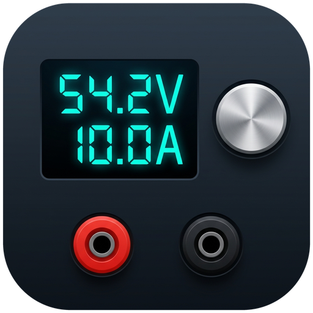

# SCPI Programmable Power Supply for Home Assistant

A local-polling Home Assistant **Device** integration for programmable SCPI bench power supplies. Compatible with standard **IEEE 488.2 / SCPI** test and measurement instruments as well as high-performance vendor dialects (such as **OWON**, **Abestop**, **Kiprim**, and **Multicomp Pro**).

Built natively on Home Assistant's **`serialx`** async serial engine (`open_serial_connection` + `usb` proxy handlers), supporting:
- **Local USB / UART serial adapters**: `/dev/ttyUSB0`, `/dev/serial/by-id/...`
- **Remote TCP / RFC2217 serial bridges** (e.g., MikroTik `/port remote-access`, `ser2net`): `socket://host:port`, `rfc2217://host:port`
- **ESPHome Serial Proxies**: `esphome://...`

---

## Supported Hardware & Dialects

The integration automatically detects the device profile from the IEEE 488.2 `*IDN?` string during setup:

- **Standard SCPI / IEEE 488.2** (`standard` profile):
  - **Brands**: Rigol, Siglent, Keysight / Agilent, Rohde & Schwarz, B&K Precision, Korad / Tenma (with SCPI bridge).
  - **Models**: Rigol `DP832`, `DP832A`, `DP831A`, `DP711`, `DP712`; Siglent `SPD3303X`, `SPD3303X-E`, `SPD1168X`, `SPD1305X`; Keysight `E36311A`, `E36103B`, `E36105B`; Rohde & Schwarz `HMP4040`, `HMP2020`, etc.
  - **Protocol Features**: Standard IEEE 488.2 queries (`MEAS:VOLT?`, `MEAS:CURR?`, `MEAS:POW?`, `VOLT:PROT`, `CURR:PROT`, `INST:NSEL`).
- **OWON & Rebrands** (`owon` profile):
  - **Brands**: OWON, and rebadges / clones (Abestop, Kiprim, Multicomp Pro).
  - **Models**: `SPE` series (`SPE3103`, `SPE6103`, `SPE6053`), `SPM` series with integrated DMM (`SPM3103`, `SPM6103`), multi-channel `ODP` series (`ODP6062`), `P4000` series (`P4603`), and clones (`AT6301`, `AT6302`, `DC310`, `DC605`, `MP7200xx`).
  - **Protocol Features**: Single-transaction composite telemetry query (`MEAS:ALL:INFO?`), hardware OVP/OCP/over-temperature trip flags, integrated DMM readback (`:READ?` on SPM series), and output state reporting.

---

## Device Feature Support Matrix

| Manufacturer / Series | Example Models | Dialect Profile | Channels | Composite Telemetry (`MEAS:ALL:INFO?`) | Output Toggle (`OUTP`) | V / I Setpoints (`VOLT` / `CURR`) | OVP / OCP Protection Limits | Hardware Trip Flags | Multimeter / DMM | Sub-Device Hierarchy |
| :--- | :--- | :--- | :---: | :---: | :---: | :---: | :---: | :---: | :---: | :---: |
| **Rigol** | DP832, DP832A, DP831A, DP711 | `standard` | 1–3 | — (discrete) | ✅ | ✅ | ✅ (`VOLT:PROT`) | — | — | Chassis + Channels 1..N |
| **Siglent** | SPD3303X, SPD1168X, SPD1305X | `standard` | 1–3 | — (discrete) | ✅ | ✅ | ✅ (`VOLT:PROT`) | — | — | Chassis + Channels 1..N |
| **Keysight / Agilent** | E36311A, E36103B, E36105B | `standard` | 1–3 | — (discrete) | ✅ | ✅ | ✅ (`VOLT:PROT`) | — | ✅ (`MEAS:VOLT:DC?`) | Chassis + Channels 1..N |
| **Rohde & Schwarz** | HMP4040, HMP2020 | `standard` | 2–4 | — (discrete) | ✅ | ✅ | ✅ (`VOLT:PROT`) | — | — | Chassis + Channels 1..N |
| **Generic SCPI** | Any IEEE 488.2 supply | `standard` | 1+ | — (discrete) | ✅ | ✅ | ✅ (if supported) | — | — | Conditional |
| **OWON Single-Ch & Rebrands** | SPE6103, SPE3103, P4603, AT6301, DC310 | `owon` | 1 | ✅ | ✅ | ✅ | ✅ (`VOLT:LIM`) | ✅ | — | Chassis (flat) |
| **OWON SPM (with DMM)** | SPM6103, SPM3103 | `owon` | 1 | ✅ | ✅ | ✅ | ✅ (`VOLT:LIM`) | ✅ | ✅ (`:READ?`) | Chassis + DMM Sub-Device |
| **OWON Multi-Channel** | ODP6062, ODP3033 | `owon` | 2–3 | ✅ | ✅ | ✅ | ✅ (`VOLT:LIM`) | ✅ | — | Chassis + Channels 1..N |

> [!NOTE]
> **Sub-Device Hierarchy**: Single-channel supplies without an integrated multimeter remain flat on the parent device to preserve existing entity IDs and dashboard configurations. Multi-channel supplies and DMM units use Home Assistant's `ChildDeviceInfo` to cleanly organize channels (`Channel 1..N`) and multimeter telemetry under the chassis device.

---

## Features

- **First-Class Device Integration (`"integration_type": "device"`)**:
  - Automatically queries `*IDN?` during setup to identify **Manufacturer**, **Model**, **Serial Number**, and **Firmware Version**.
  - Default device name is `<Manufacturer> <Model>` (e.g., `Rigol DP832` or `Abestop AT6301`) unless overridden during setup.
- **Dual Dialect Profiles**:
  - **OWON Profile**: Uses composite telemetry (`MEAS:ALL:INFO?`) returning voltage, current, power, OVP/OCP/over-temperature flags, and operating modes in a single transaction.
  - **Standard SCPI Profile**: Standard IEEE 488.2 queries (`MEAS:VOLT?`, `MEAS:CURR?`, `MEAS:POW?`, `VOLT:PROT`, `CURR:PROT`).
- **Hardware Safety Clamps**:
  - Optional **Safety Max Voltage Clamp** and **Safety Max Current Clamp** in Config and Options flows.
  - Hard enforced in the Home Assistant UI (`NumberEntity.native_max_value`) and SCPI command validation (`VOLT` and `VOLT:LIM`/`VOLT:PROT`) to prevent automations or accidental slider interactions from exceeding safe load limits.
- **Robust Serial Concurrency & Framing**:
  - Serialized via `asyncio.Lock` with automatic RX buffer flushing to eliminate desynchronized or shifted replies over remote networks.
  - Safe state preservation: Never blindly toggles `OUTP OFF` on Home Assistant restart; live state is polled from the hardware.

---

## Entities Created per Device

| Category | Entity | Type | Description |
| :--- | :--- | :--- | :--- |
| **Controls** | `Output` | `switch` | Turns DC output ON/OFF (`OUTP ON` / `OUTP OFF`), synced with hardware state |
| **Settings** | `Voltage Target` | `number` | Voltage setpoint in Volts (e.g., `VOLT 13.80`) with hardware/software safety limits |
| **Settings** | `Current Limit` | `number` | Current limit setpoint in Amperes (e.g., `CURR 3.00`) |
| **Sensors** | `Voltage` | `sensor` (`voltage`, V) | Live measured output voltage |
| **Sensors** | `Current` | `sensor` (`current`, A) | Live measured output current |
| **Sensors** | `Power` | `sensor` (`power`, W) | Real-time output power calculated/polled from supply |
| **Sensors** | `Mode` | `sensor` | Operating mode: `Constant Voltage (CV)`, `Constant Current (CC)`, or `OFF` |

---

## Installation via HACS

1. Click the **Add to HACS** button above, or manually add `https://github.com/Kludgenics/ha-scpi-psu` as a custom repository under **HACS** → **Integrations** → **Custom repositories** (Category: `Integration`).
2. Search for **SCPI Power Supply** and click **Download**.
3. Restart Home Assistant.

---

## Configuration

1. Navigate to **Settings** → **Devices & Services** → **Add Integration**.
2. Search for **SCPI Power Supply**.
3. Select your serial port or enter a socket connection:
   - For USB adapters: select `/dev/serial/by-id/...` or `/dev/ttyUSB0`
   - For MikroTik / ser2net: `socket://192.168.88.1:4001` or `rfc2217://192.168.88.1:4001`
4. Confirm communication and adjust default voltage/current clamp limits.

## Development

The standalone client and its tests live in `packages/scpi_psu_client`. Edit the client there; the integration's `scpi_psu_client` directory is generated. Run `python3 scripts/build_integration.py` to synchronize that copy and create a self-contained HACS archive in `dist/scpi_psu.zip`. CI checks that the checked-in copy matches the package source.

Run the Home Assistant tests with `.venv/bin/pytest tests`, the standalone client tests with `.venv/bin/pytest packages/scpi_psu_client/tests`, or both with `.venv/bin/pytest`. The client can also be tested independently from its own directory after installing its `test` extra.
