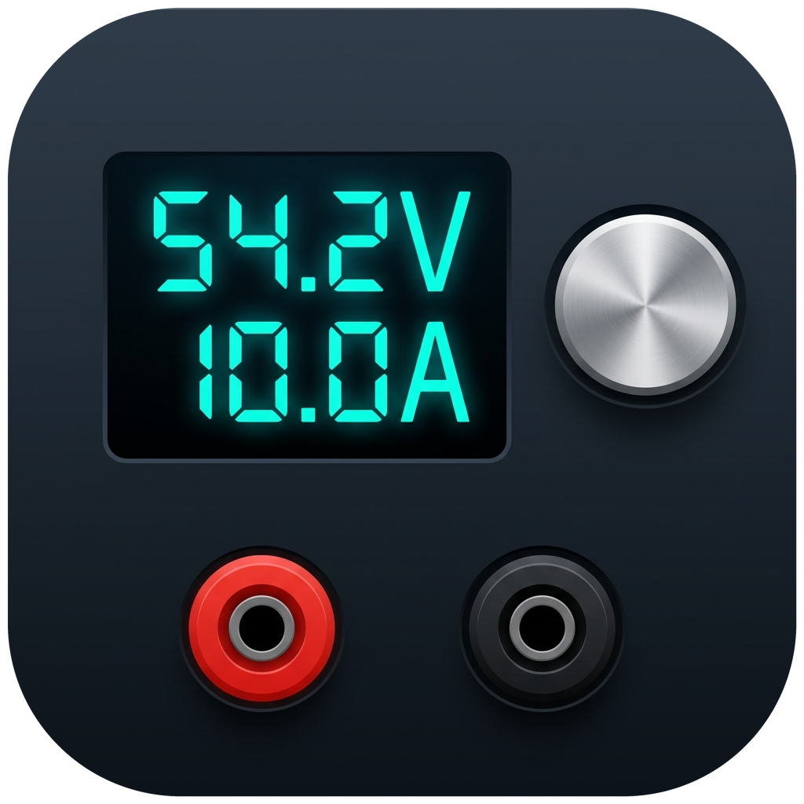

# SCPI Programmable Power Supply for Home Assistant

  

A local-polling Home Assistant **Device** integration for programmable SCPI bench power supplies. Compatible with standard **IEEE 488.2 / SCPI** test and measurement instruments as well as high-performance vendor dialects (such as **OWON**, **Abestop**, **Kiprim**, and **Multicomp Pro**).

Built natively on Home Assistant's **`serialx`** async serial engine (`open_serial_connection` + `usb` proxy handlers), supporting:
- **Local USB / UART serial adapters**: `/dev/ttyUSB0`, `/dev/serial/by-id/...`
- **Remote TCP / RFC2217 serial bridges** (e.g., MikroTik `/port remote-access`, `ser2net`): `socket://host:port`, `rfc2217://host:port`
- **ESPHome Serial Proxies**: `esphome://...`

---

## Supported Hardware

- **Standard SCPI / IEEE 488.2**: Rigol (DP800 series), Siglent (SPD series), Keysight, Rohde & Schwarz, Korad/Tenma (via SCPI bridging).
- **OWON & Rebranded Dialect**: OWON `SPE`, `SPM`, `ODP`, `P4000` series; Abestop `AT6301` / `AT6302`; Kiprim `DC310` / `DC605`; Multicomp Pro `MP7200xx`.
  - Automatically activates single-transaction composite telemetry (`MEAS:ALL:INFO?`) for instant, low-latency updates.

---

## Features

- **First-Class Device Integration (`"integration_type": "device"`)**:
  - Automatically queries `*IDN?` during setup to identify **Manufacturer**, **Model**, **Serial Number**, and **Firmware Version**.
  - Default device name is `<Manufacturer> <Model>` (e.g., `Rigol DP832` or `Abestop AT6301`) unless overridden during setup.
- **Dual Dialect Profiles**:
  - **OWON Profile**: Uses composite telemetry (`MEAS:ALL:INFO?`) returning voltage, current, power, OVP/OCP/OPP limits, and operating modes in a single transaction.
  - **Standard SCPI Profile**: Standard IEEE 488.2 queries (`MEAS:VOLT?`, `MEAS:CURR?`, `MEAS:POW?`, `VOLT:PROT`, `CURR:PROT`).
- **Hardware Safety Clamps**:
  - Optional **Safety Max Voltage Clamp** and **Safety Max Current Clamp** in Config and Options flows.
  - Hard enforced in the Home Assistant UI (`NumberEntity.native_max_value`) and SCPI command validation (`VOLT` and `VOLT:LIM`/`VOLT:PROT`) to prevent automations or accidental slider interactions from exceeding safe load limits.
- **Robust Serial Concurrency & Framing**:
  - Serialized via `asyncio.Lock` with automatic RX buffer flushing to eliminate desynchronized or shifted replies over remote networks.
  - Safe state preservation: Never blindly toggles `OUTP OFF` on Home Assistant restart; live state is polled from the hardware.

---

## Entities Created per Device

| Category | Entity | Type | Description |
| :--- | :--- | :--- | :--- |
| **Controls** | `Output` | `switch` | Turns DC output ON/OFF (`OUTP ON` / `OUTP OFF`), synced with hardware state |
| **Controls** | `Voltage Setpoint` | `number` | Output voltage setpoint (`VOLT`), bounded by hardware rating & safety clamp |
| **Controls** | `Current Setpoint` | `number` | Constant-current setpoint (`CURR`), bounded by hardware rating & safety clamp |
| **Sensors** | `Voltage` | `sensor` | Measured output terminal voltage (`V`) |
| **Sensors** | `Current` | `sensor` | Measured output current (`A`) |
| **Sensors** | `Power` | `sensor` | Measured output power (`W`) |
| **Sensors** | `Status` | `sensor` | Operating state (`Constant Voltage (CV)`, `Constant Current (CC)`, `Standby / Output Off`, `Fault / Protection Trip`) |
| **Sensors** | `Fault` | `binary_sensor` | `on` if any protection trip (OVP/OCP/OPP/Fault) is active |
| **Config** | `Overvoltage Limit` | `number` | Hardware OVP trip threshold (`VOLT:LIM` / `VOLT:PROT`) |
| **Config** | `Overcurrent Limit` | `number` | Hardware OCP trip threshold (`CURR:LIM` / `CURR:PROT`) |
| **Config** | `Clear Fault` | `button` | Sends `*CLS` to clear latched protection trips/errors |
| **Diagnostic** | `Connected` | `binary_sensor` | `serialx` transport & SCPI responsiveness status |
| **Diagnostic** | `Overvoltage Protection (OVP)` | `binary_sensor` | Individual OVP trip indicator |
| **Diagnostic** | `Overcurrent Protection (OCP)` | `binary_sensor` | Individual OCP trip indicator |
| **Diagnostic** | `Overpower Protection (OPP)` | `binary_sensor` | Individual OPP trip indicator |
| **Diagnostic** | `Error Register` | `sensor` | Raw `SYST:ERR?` diagnostic register |

---

## Installation

### Method 1: HACS (Recommended)

1. Click the **Add to HACS** button above, or manually add `https://github.com/Kludgenics/ha-scpi-psu` as a custom repository under **HACS** → **Integrations** → **Custom repositories** (Category: `Integration`).
2. Download **SCPI Power Supply** and restart Home Assistant.

### Method 2: Manual Installation

1. Copy `custom_components/scpi_psu` into your Home Assistant `<config_dir>/custom_components/` directory.
2. Restart Home Assistant.

---

## Configuration

1. In Home Assistant, go to **Settings** → **Devices & Services** → **Add Integration** and search for **SCPI Power Supply** (or click the badge above).
2. Enter your serial path or socket URL:
   - Local: `/dev/ttyUSB0` or `/dev/serial/by-id/...`
   - TCP Bridge (e.g. MikroTik or ser2net): `socket://192.168.88.1:4001`
   - RFC2217 Bridge: `rfc2217://192.168.88.1:4001`
3. (Optional) Set safety voltage/current limits and custom polling interval.
